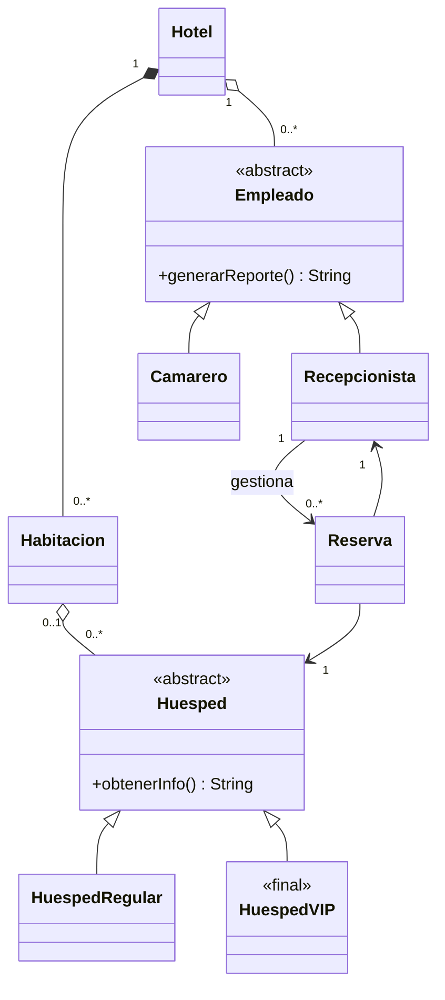

# Hotel Sabana Real

Proyecto final de Programación Orientada a Objetos. Aplicación de consola en Java para registrar huéspedes, alojarlos, consultar la ocupación y gestionar reservas por recepcionista.

**Integrantes**

- Santiago Mantilla
- David Saavedra
- Alexander Vanegas

## Ejecutar

Requiere un JDK 11 o superior. No usa bibliotecas externas. En VS Code, abre la carpeta que contiene este README y ejecuta el método `main` de `src/com/hotel/app/App.java` con la extensión de Java. En la terminal, desde esa misma carpeta:

```sh
javac -encoding UTF-8 -d out -sourcepath src src/com/hotel/app/App.java
java -cp out com.hotel.app.App
```

## Estructura

| Ruta | Contenido |
|---|---|
| `src/com/hotel/modelo/` | Hotel, habitaciones, empleados, huéspedes, reservas y validaciones |
| `src/com/hotel/excepciones/` | Cuatro excepciones comprobadas del dominio |
| `src/com/hotel/app/App.java` | Menú, lectura del teclado y recuperación ante errores |
| `docs/diagrama-hotel.puml` | Diagrama de clases completo y editable en PlantUML |
| `docs/Sustentacion.md` | Recorrido de demostración y preguntas sobre la implementación |
| `pruebas/probar_menu.py` | Pruebas repetibles de la consola con Python 3 y Java |

## Diagrama de clases

[Ver el diagrama completo con atributos y métodos en PlantUML](docs/diagrama-hotel.puml). Esta vista resume las relaciones del dominio.



## Decisiones de funcionamiento

- **Registro y alojamiento.** La opción 1 guarda a la persona en el registro de la sesión. La opción 3 la aloja en una habitación con cupo. Las opciones 4 y 8 buscan en las habitaciones, así que exigen que la persona esté alojada. La opción 2 lista a todos los registrados.
- **Check-out.** La opción 7 libera el cupo. La persona sigue registrada y el recepcionista conserva el historial de reservas. Puede volver a alojarse sin repetir el registro.
- **Identidad.** El documento se conserva como texto para respetar los ceros iniciales. Se rechazan documentos duplicados, habitaciones repetidas y un segundo alojamiento simultáneo desde el menú. El número de habitación es un identificador de texto y admite letras.
- **Reservas.** Se pide una fecha real en formato AAAA-MM-DD. Se admiten fechas pasadas y futuras. Cada reserva registra un servicio para un huésped alojado. Se pueden registrar varios servicios en la misma fecha. Reservar no altera la ocupación.
- **Datos en memoria.** Al reiniciar se restablecen las habitaciones 101, 102 y 201, con capacidades 2, 3 y 4, y el personal inicial R001, R002 y C001.
- **Errores.** Una entrada que no es un entero se vuelve a pedir. Un valor entero fuera del rango de negocio cancela la operación y regresa al menú. El fin de la entrada cierra el programa incluso a mitad de un registro.

## Demostración rápida

Registra un huésped en 1, alójalo en 3, crea una reserva con R001 en 4 y consúltala en 6. Ejecuta 9 antes y después de liberarlo con 7 para comprobar el cambio de ocupación. Para repetir las pruebas automatizadas, compila el proyecto y ejecuta `python pruebas/probar_menu.py` con `java` disponible en el PATH.
